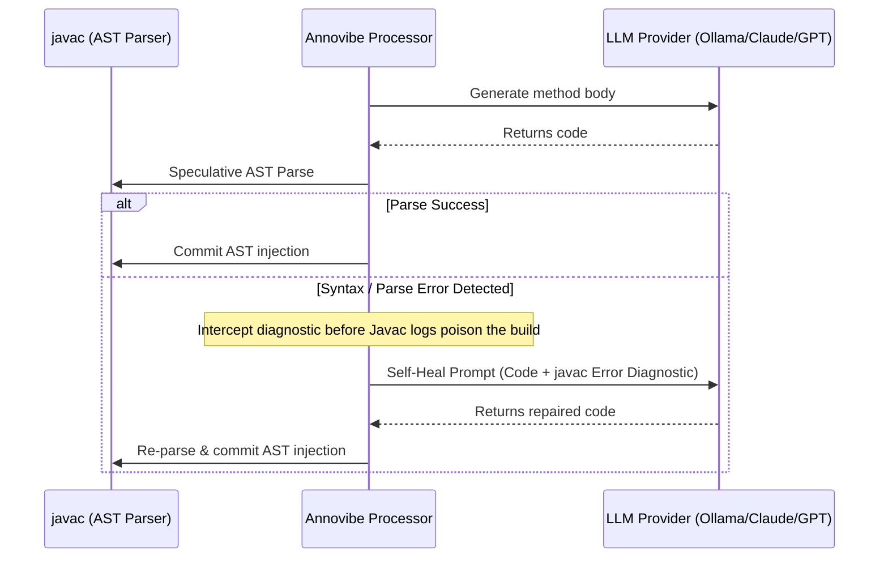

# Annovibe ⚡

> Compile-time AI code generation for Java. Write the prompt, vibe the code.

<p align="center">
  
</p>

Annovibe is a Java library and annotation processor that generates method bodies and class definitions at compile time using LLMs (OpenRouter, OpenAI, Anthropic, Ollama).

---

## Quick Overview

Why copy-paste the same 40-line StackOverflow snippet for the 50th time when you can let an LLM synthesize it directly at compile-time?

```java
import io.annovibe.AI;
import io.annovibe.vibe;
import java.time.LocalDate;

public class SanityUtils {

    @vibe("format raw bytes into a human-readable string like '1.4 MB' or '512 KB' using 1024 base")
    public static String formatBytes(long bytes) {
        return null; // Never Google this StackOverflow snippet again
    }

    @AI("calculate deadline: take startDate, add n business days skipping Saturdays and Sundays")
    public static LocalDate addBusinessDays(LocalDate startDate, int businessDays) {
        return null; // Date math without the existential dread
    }

    @vibe("validate credit card number using the Luhn algorithm checksum: return true if valid, false otherwise")
    public static boolean isValidCreditCard(String cardNumber) {
        return false; // Full checksum logic compiled straight into bytecode
    }
}
```

Run `mvn compile` and `javac` compiles the generated logic directly into `.class` bytecode. There are no runtime AI calls or added latency.

---

## Features

- **`@AI`, `@vibe`, and `@Vibe` Annotations**: Annotate any method or class with natural language instructions. Supports both lowercase `@vibe` and PascalCase `@Vibe` (`import io.annovibe.annotations.Vibe`).
- **1-Shot Self-Healing Compiler Loop**: If an LLM returns code with a syntax error or missing token, Annovibe captures the `javac` diagnostic and prompts the model to repair the code in real time during compilation. Bounded by `annovibe.selfHealing.maxRetries` (default: 1) to prevent runaway token usage.
- **Direct AST Injection**: Generates and injects code into `.class` bytecode during `javac` compilation without altering source files.
- **Supported LLM Providers**:
  - **Local Ollama** (auto-detected when running locally on `http://localhost:11434`)
  - **OpenRouter** (`https://openrouter.ai/api/v1/chat/completions`)
  - **OpenAI** (`https://api.openai.com/v1/chat/completions`)
  - **Anthropic** (`https://api.anthropic.com/v1/messages`)
  - **Mock**: Deterministic local testing mode
- **Multi-Class Coherence**: Analyzes compilation units to pass sibling class signatures and field definitions to the model, so interdependent components match.
- **Compile-Time Caching**: Disk-backed SHA-256 caching under `.annovibe/cache` avoids repeated API calls and speeds up rebuilds.
- **Source Materialization**: Optional `-Aannovibe.materialize=true` mode writes generated code directly into your `.java` files for version control.

---

## 1-Shot Self-Healing Compiler

LLMs occasionally return syntax errors such as a missing semicolon, unmatched parenthesis, or stray markdown block. In standard annotation processors, this immediately fails the `mvn compile` build.

Annovibe catches these diagnostics and attempts to repair the code during compilation:



### Bounded Recursion and Token Safety

To prevent infinite retry loops and unnecessary API usage, self-healing retries are bounded:
- `annovibe.selfHealing.maxRetries=1` sets the maximum retry limit (default: 1).
- If the model cannot resolve the error within the configured retries, Annovibe fails fast and prints the compiler diagnostic directly so you can adjust your prompt.

---

## Installation

### Maven

Add the JitPack repository and Annovibe dependencies to your `pom.xml`:

```xml
<repositories>
    <repository>
        <id>jitpack.io</id>
        <url>https://jitpack.io</url>
    </repository>
</repositories>

<dependencies>
    <dependency>
        <groupId>com.github.RythenGlyth.Annnovibe</groupId>
        <artifactId>annovibe-core</artifactId>
        <version>v1.0.1</version>
    </dependency>
</dependencies>

<build>
    <plugins>
        <plugin>
            <groupId>org.apache.maven.plugins</groupId>
            <artifactId>maven-compiler-plugin</artifactId>
            <version>3.13.0</version>
            <configuration>
                <annotationProcessorPaths>
                    <path>
                        <groupId>com.github.RythenGlyth.Annnovibe</groupId>
                        <artifactId>annovibe-processor</artifactId>
                        <version>v1.0.1</version>
                    </path>
                </annotationProcessorPaths>
                <fork>true</fork>
                <compilerArgs>
                    <arg>-J--add-exports=jdk.compiler/com.sun.tools.javac.processing=ALL-UNNAMED</arg>
                    <arg>-J--add-exports=jdk.compiler/com.sun.tools.javac.tree=ALL-UNNAMED</arg>
                    <arg>-J--add-exports=jdk.compiler/com.sun.tools.javac.util=ALL-UNNAMED</arg>
                    <arg>-J--add-exports=jdk.compiler/com.sun.tools.javac.parser=ALL-UNNAMED</arg>
                    <arg>-J--add-exports=jdk.compiler/com.sun.tools.javac.file=ALL-UNNAMED</arg>
                    <arg>-J--add-exports=jdk.compiler/com.sun.tools.javac.code=ALL-UNNAMED</arg>
                </compilerArgs>
            </configuration>
        </plugin>
    </plugins>
</build>
```

### Gradle (Kotlin DSL)

```kotlin
repositories {
    mavenCentral()
    maven { url = uri("https://jitpack.io") }
}

dependencies {
    implementation("com.github.RythenGlyth.Annnovibe:annovibe-core:v1.0.1")
    annotationProcessor("com.github.RythenGlyth.Annnovibe:annovibe-processor:v1.0.1")
}

tasks.withType<JavaCompile> {
    options.isFork = true
    options.forkOptions.jvmArgs?.addAll(listOf(
        "--add-exports=jdk.compiler/com.sun.tools.javac.processing=ALL-UNNAMED",
        "--add-exports=jdk.compiler/com.sun.tools.javac.tree=ALL-UNNAMED",
        "--add-exports=jdk.compiler/com.sun.tools.javac.util=ALL-UNNAMED",
        "--add-exports=jdk.compiler/com.sun.tools.javac.parser=ALL-UNNAMED",
        "--add-exports=jdk.compiler/com.sun.tools.javac.file=ALL-UNNAMED",
        "--add-exports=jdk.compiler/com.sun.tools.javac.code=ALL-UNNAMED"
    ))
}
```

### Build from Source

```bash
git clone https://github.com/RythenGlyth/Annnovibe.git
cd Annnovibe
mvn clean install
```

---

## Quick Start Guide

### Provider Setup and API Keys

Annovibe supports local models and cloud providers:

#### Local Ollama (Zero Configuration)
If you run Ollama locally (`ollama run llama3.2` or `codellama`), Annovibe automatically connects to `http://localhost:11434` when no cloud API keys are present. No API keys or remote network requests are required.

#### Cloud LLM Providers
Set the environment variable for your chosen provider:
```bash
# OpenRouter (default fallback)
export OPENROUTER_API_KEY="sk-or-v1-..."

# Or OpenAI
export OPENAI_API_KEY="sk-..."

# Or Anthropic
export ANTHROPIC_API_KEY="sk-ant-..."
```

---

## Configuration Guide

Annovibe supports configuration at several levels, resolved in order of precedence:

1. **Annotation attributes**: per-method or per-class (`@AI(model = "...", cache = false)` or `@Vibe(...)`)
2. **Compiler arguments (`-A`)**: passed to Maven or javac (`-Aannovibe.materialize=true`)
3. **`annovibe.properties`**: file in the project root
4. **System properties (`-D`)**: passed to the JVM (`-Dannovibe.cache=false`)
5. **Environment variables**: (`OPENROUTER_API_KEY`, etc.)

---

### Compile-Time Caching

To avoid repeated API calls and latency during builds, Annovibe caches generated code on disk under `.annovibe/cache`:

- **Cache keys**: Annovibe computes a SHA-256 hash of `provider + model + prompt + method signature + sibling context` and stores the generated Java snippet as `.annovibe/cache/<hash>.java`.
- **Fast rebuilds**: If the prompt and method signature are unchanged, compilation takes under 5ms without making API calls.
- **Offline and CI builds**: You can commit the `.annovibe/cache` directory to git so CI pipelines or offline environments compile without network access or API tokens.

#### Caching Options

| Setting | Configuration | Description |
| :--- | :--- | :--- |
| **Disable globally** | `annovibe.cache=false` in `annovibe.properties` or `-Aannovibe.cache=false` | Forces live LLM generation on every compile |
| **Bypass per method** | `@AI(value = "...", cache = false)` or `@vibe(cache = false)` or `@Vibe(cache = false)` | Disables caching only for this element |
| **Custom directory** | `annovibe.cacheDir=/path/to/cache` | Changes cache location (defaults to `.annovibe/cache`) |
| **Clear cache** | `rm -rf .annovibe/cache` | Invalidates all cached generations |

---

### In-Memory AST Injection vs. Source Materialization

Annovibe supports two compilation modes:

#### 1. In-Memory AST Injection (Default)
By default, Annovibe modifies the compiler AST in memory:
- Source `.java` files remain unchanged, containing only your `@AI`, `@vibe`, or `@Vibe` annotations and stubs.
- Compiled `.class` files contain the full generated implementation bytecode.
- Keeps source files concise while delegating boilerplate implementation to compile time.

#### 2. Source Materialization Mode (`-Aannovibe.materialize=true`)
Materialization writes the generated implementations directly into your `.java` files on disk:
- **Use cases**:
  - Review generated code in git diffs before committing.
  - Set breakpoints and step through generated code in standard IDE debuggers.
  - Allow team members or CI environments without LLM API keys to build the project.
- **How to enable**:
  Add `-Aannovibe.materialize=true` to the `compilerArgs` in `pom.xml`:
  ```xml
  <compilerArgs>
      <arg>-Aannovibe.materialize=true</arg>
      <!-- Javac internal exports -->
      <arg>-J--add-exports=jdk.compiler/com.sun.tools.javac.processing=ALL-UNNAMED</arg>
      <arg>-J--add-exports=jdk.compiler/com.sun.tools.javac.tree=ALL-UNNAMED</arg>
      <arg>-J--add-exports=jdk.compiler/com.sun.tools.javac.util=ALL-UNNAMED</arg>
      <arg>-J--add-exports=jdk.compiler/com.sun.tools.javac.parser=ALL-UNNAMED</arg>
      <arg>-J--add-exports=jdk.compiler/com.sun.tools.javac.file=ALL-UNNAMED</arg>
      <arg>-J--add-exports=jdk.compiler/com.sun.tools.javac.code=ALL-UNNAMED</arg>
  </compilerArgs>
  ```
  Or invoke on demand from the CLI:
  ```bash
  mvn compile -DcompilerArgs="-Aannovibe.materialize=true"
  ```

---

### Full `annovibe.properties` Reference

Create an `annovibe.properties` file in your project root to customize defaults:

```properties
# LLM Provider: ollama | openrouter | openai | anthropic | mock (default: auto-detected)
annovibe.provider=ollama

# Model name (default: llama3.2 for ollama, claude-3-5-sonnet for anthropic, gpt-4o for openai)
annovibe.model=llama3.2

# Local Ollama endpoint (default: http://localhost:11434)
annovibe.ollama.url=http://localhost:11434

# Custom Base URL (e.g. for custom vLLM / OpenAI-compatible endpoints)
# annovibe.baseUrl=http://localhost:8000/v1/chat/completions

# Provider API keys (alternative to environment variables)
annovibe.openrouter.apiKey=sk-or-v1-...
annovibe.openai.apiKey=sk-...
annovibe.anthropic.apiKey=sk-ant-...

# 1-Shot Self-Healing Compiler
annovibe.selfHealing=true
# Max self-healing retry iterations to protect token usage (default: 1)
annovibe.selfHealing.maxRetries=1

# Generation temperature (default: 0.2)
annovibe.temperature=0.2

# Caching: true | false (default: true)
annovibe.cache=true

# Cache storage directory (default: .annovibe/cache)
annovibe.cacheDir=.annovibe/cache

# Project-wide global prompt / architectural rules injected into all generations
annovibe.globalPrompt=Prefer immutability. Use java.time for dates. Use Optional for nullable returns.

# Materialize generated code to source files (default: false)
annovibe.materialize=false
```

## Code Examples

### Method Generation

```java
import io.annovibe.AI;
import io.annovibe.vibe;

public class MathUtils {

    @AI("calculate the factorial of n recursively; if n <= 1 return 1L")
    public static long factorial(int n) {
        return 0L; // Stub is replaced during javac compilation!
    }

    @vibe("return true if str is a palindrome ignoring whitespace and case")
    public static boolean isPalindrome(String str) {
        return false;
    }
}
```

### Multi-Component Coherence

```java
public class UserRepository {
    private final Map<String, User> store = new ConcurrentHashMap<>();

    @AI("save user into store keyed by id and return the saved user")
    public User save(User user) {
        return null;
    }

    @AI("find and return user from store matching id, or null if not found")
    public User findById(String id) {
        return null;
    }
}

public class UserService {
    private final UserRepository repo;

    public UserService(UserRepository repo) {
        this.repo = repo;
    }

    @vibe("create a new User with id and email, save user into repo, and return it")
    public User registerUser(String id, String email) {
        return null;
    }
}
```

---

## Verification

Run all unit and integration tests:
```bash
mvn clean test
```
